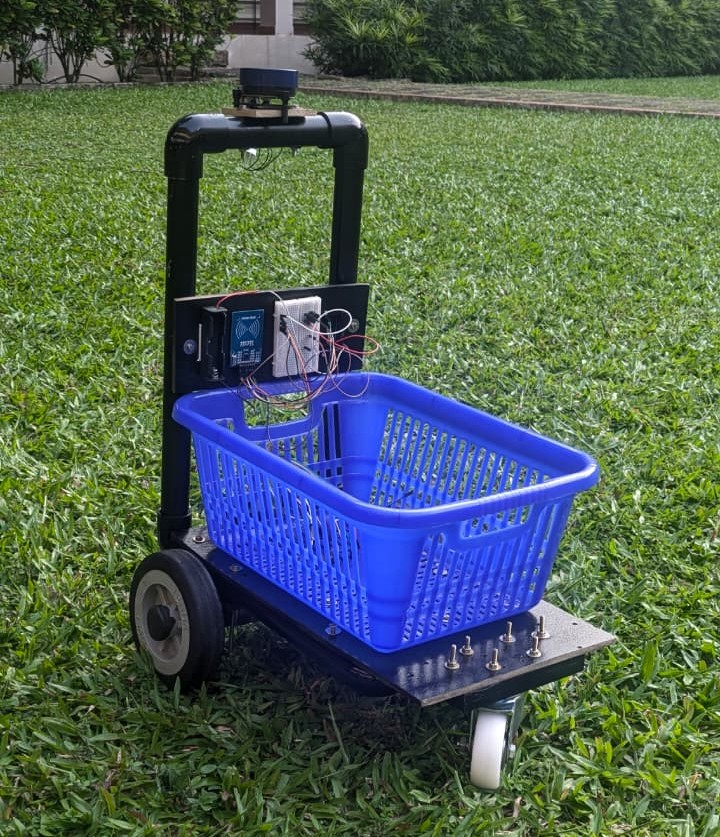
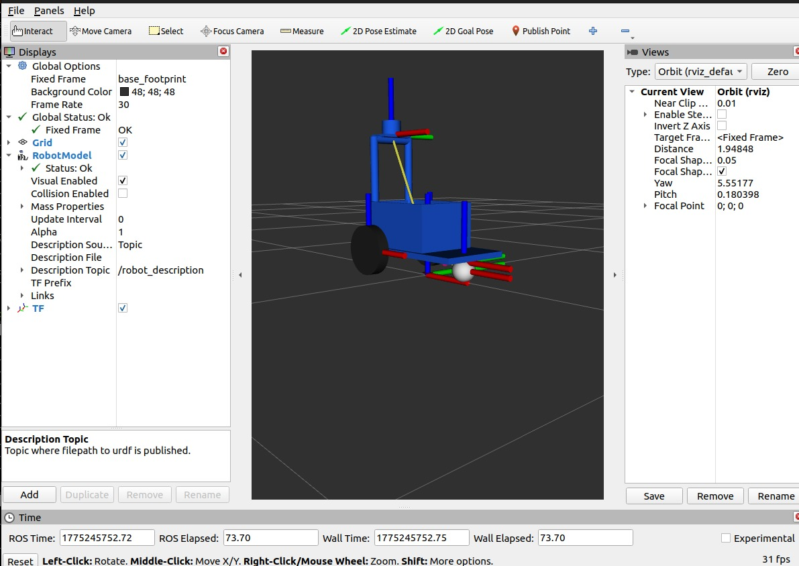
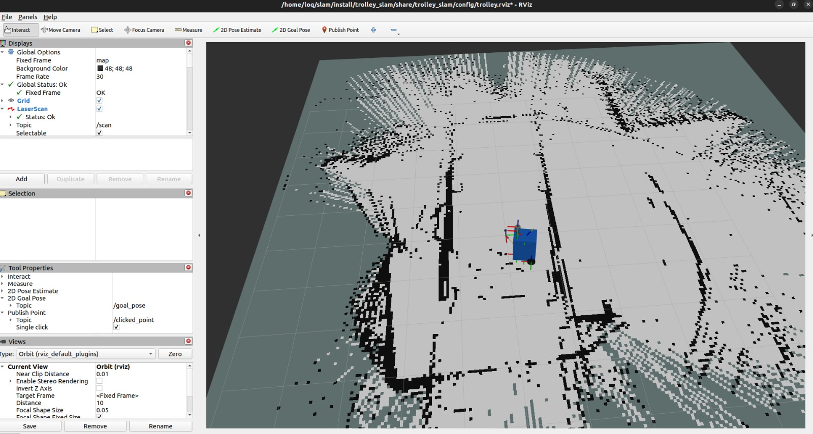
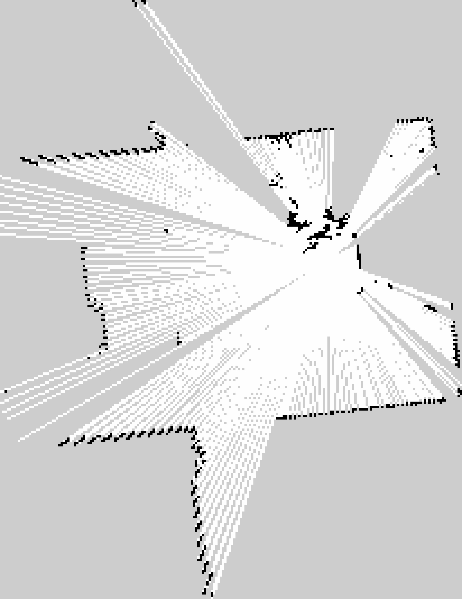
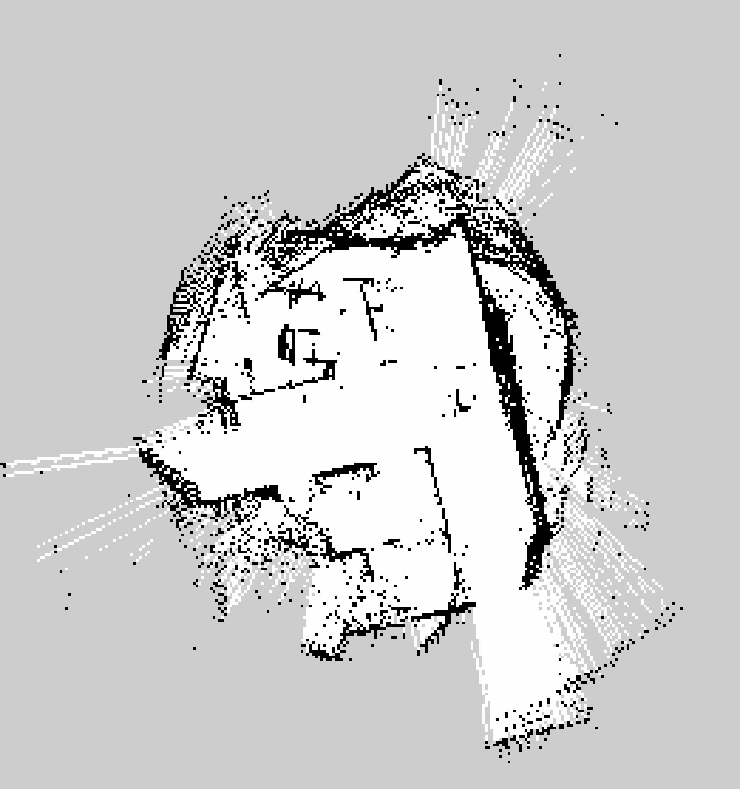

# Smart Shopping Trolley with Autonomous Navigation

An integrated engineering project combining RFID-based product identification, automated billing, inventory management, digital receipt delivery, and autonomous robotics.

The project brings together electronics and instrumentation, embedded systems, software development, sensor integration, and mobile robotics to develop a smarter shopping experience.

---

## Table of Contents

- [Project Overview](#project-overview)
- [Objectives](#objectives)
- [Key Features](#key-features)
- [Project Gallery](#project-gallery)
- [System Architecture](#system-architecture)
- [Hardware Components](#hardware-components)
- [Software and Technologies](#software-and-technologies)
- [Smart Billing and Product Identification](#smart-billing-and-product-identification)
- [Inventory Management](#inventory-management)
- [Digital Receipt and Email Integration](#digital-receipt-and-email-integration)
- [Autonomous Navigation and SLAM](#autonomous-navigation-and-slam)
- [Repository Structure](#repository-structure)
- [Installation and Setup](#installation-and-setup)
- [Mapping Results](#mapping-results)
- [Project Status](#project-status)
- [Future Improvements](#future-improvements)
- [Author](#author)

---

## Project Overview

The Smart Shopping Trolley integrates smart shopping functionalities with an autonomous mobile robotic platform.

The system combines RFID-based product identification, automated billing, trolley weight measurement, inventory monitoring, and digital receipt generation with ROS 2-based robotic development.

The project consists of two closely integrated subsystems.

### 1. Smart Shopping and Automated Billing

This subsystem focuses on automating the shopping and billing process through RFID-based product identification, product and price management, weight measurement, inventory monitoring, and electronic receipt delivery.

### 2. Autonomous Robotics

This subsystem focuses on robotic modelling, LiDAR-based environmental sensing, indoor mapping, and autonomous navigation using ROS 2.

The project demonstrates the integration of embedded electronics, instrumentation, software systems, and mobile robotics within a single engineering application.

## Objectives

- Develop a smart shopping trolley prototype.
- Implement RFID-based product identification.
- Integrate automated billing functionality.
- Measure the weight of products placed in the trolley.
- Maintain product inventory records.
- Generate digital receipts and deliver them through email.
- Develop a ROS 2-based robotic platform.
- Integrate YDLIDAR for environmental perception.
- Generate indoor maps using SLAM.
- Develop the foundation for autonomous trolley navigation.
- Integrate embedded systems and robotics into one platform.

---

## Key Features

### 1. RFID-Based Product Identification

- Identify products using RFID tags.
- Retrieve associated product information.
- Integrate product identification with the billing workflow.

### 2. Automated Billing

- Calculate the total shopping bill automatically.
- Associate identified products with their prices.
- Maintain a record of products included in a transaction.

### 3. Trolley Weight Measurement

- Measure the weight of products placed in the trolley.
- Use weight measurements as an additional source of information about trolley contents.

### 4. Inventory Management

- Maintain product inventory records.
- Track product quantities.
- Identify products whose stock falls below configured thresholds.

### 5. Digital Receipt Generation

- Generate electronic receipts after billing.
- Deliver digital receipts to customers through email.
- Reduce dependence on printed receipts.

### 6. Autonomous Robotics

- ROS 2-based robotic development.
- YDLIDAR integration.
- Indoor environment mapping using SLAM.
- Robot modelling using URDF/Xacro.
- RViz visualization.
- Gazebo simulation development.
- Foundation for autonomous navigation.

---

## Project Gallery

### Physical Smart Shopping Trolley

The physical trolley prototype developed for the project.



### Robot Model in RViz

The trolley robot model visualized using its URDF/Xacro description.



### LiDAR and SLAM Visualization

RViz visualization showing the robot model and LiDAR mapping data during development.



---

## System Architecture

The system combines smart shopping functionality with an autonomous robotics subsystem.

### Smart Shopping Subsystem

```text
        RFID Tags on Products
                 |
                 v
             RFID Reader
                 |
                 v
       Product Identification
                 |
                 v
          Product Database
                 |
                 v
          Automated Billing
                 |
          +------+------+
          |             |
          v             v
   Inventory Update   Digital Receipt
                          |
                          v
                    Email Delivery
```

Trolley weight measurement provides an additional measurement input that can support monitoring of trolley contents.

### Autonomous Robotics Subsystem

```text
          YDLIDAR Sensor
                 |
                 v
          LiDAR Scan Data
                 |
                 v
              ROS 2
                 |
                 v
          SLAM and Mapping
                 |
                 v
          Environment Map
                 |
                 v
       Localization and Planning
                 |
                 v
        Autonomous Navigation
```

The diagram represents the overall functional architecture. The availability of individual functions depends on the corresponding hardware and software implementation.

---

## Hardware Components

| Component | Purpose |
|---|---|
| Trolley chassis and wheels | Mobile platform |
| DC geared motors | Drive mechanism |
| Motor driver | Motor control |
| Wheel encoders | Motion feedback, where integrated |
| YDLIDAR sensor | Environmental scanning |
| RFID reader and RFID tags | Product identification |
| Weight sensor and associated electronics | Trolley weight measurement |
| Embedded controller | Sensor interfacing and control |
| Battery or power supply | System power |

The exact hardware configuration depends on the subsystem and prototype revision.

## Software and Technologies

| Technology | Application |
|---|---|
| ROS 2 Humble | Robotics middleware |
| Ubuntu Linux | Development environment |
| Python | Application development and robotics scripting |
| C++ | ROS 2 driver development |
| YDLIDAR ROS 2 Driver | LiDAR integration |
| SLAM | Indoor mapping |
| RViz | Robot and sensor visualization |
| URDF/Xacro | Robot description and modelling |
| Gazebo | Robot simulation development |
| Git | Version control |
| GitHub | Source code hosting and project documentation |

---

## Smart Billing and Product Identification

The smart billing subsystem uses RFID-based product identification to support the shopping transaction.

Products can be associated with RFID tags and corresponding product records containing information such as product name and price.

When a product is identified, the billing application can retrieve its associated information and incorporate it into the current transaction.

The billing subsystem calculates the total amount based on the products and prices recorded for the transaction.

Trolley weight measurement provides an additional measurement that can be used to help monitor trolley contents.

## Inventory Management

Inventory management maintains product quantity information associated with the shopping system.

The inventory subsystem can track changes in product quantities and identify items whose available stock falls below configured thresholds.

Inventory records can support stock monitoring and help identify products that may require replenishment.

The exact inventory update workflow depends on how the billing application and product database are integrated.

## Digital Receipt and Email Integration

The digital receipt subsystem provides an electronic record of a completed shopping transaction.

After billing, the system generates a digital receipt and delivers it to the customer's email address.

Depending on the implemented receipt format, the receipt may contain:

- Product names.
- Product quantities.
- Individual product prices.
- Total transaction amount.
- Transaction information.

Digital receipts reduce dependence on printed receipts and allow customers to retain an electronic record of their purchases.

---

## Autonomous Navigation and SLAM

The autonomous robotics subsystem is developed using ROS 2.

### Robot Modelling

The trolley robot is described using URDF/Xacro.

The robot description defines its links, joints, and visual properties and provides a foundation for visualization and further simulation development.

### LiDAR Integration

A YDLIDAR sensor provides laser scan data for environmental perception.

The ROS 2 driver makes scan information available to compatible ROS 2 tools and mapping components.

### SLAM and Indoor Mapping

Simultaneous Localization and Mapping (SLAM) enables a robot to build a map of an environment while estimating its movement within that environment.

During development, LiDAR-based mapping was tested in indoor environments, including a corridor and a room.

The resulting map images are included in this repository.

### Autonomous Navigation

The mapping and robot modelling components provide a foundation for autonomous navigation.

Further integration can include localization, path planning, obstacle avoidance, and Nav2, depending on the final hardware and software configuration.

---

## Repository Structure

```text
engineering-portfolio/
|
|-- README.md
|
|-- projects/
    |
    |-- smart-shopping-trolley/
        |
        |-- README.md
        |
        |-- images/
        |   |-- trolley-prototype.jpg
        |   |-- robot-model-rviz.jpg
        |   |-- slam-visualization.jpg
        |   |-- mapping-corridor.jpg
        |   |-- mapping-room.jpg
        |
        |-- maps/
        |   |-- my_house_map.jpg
        |   |-- my_house_map1.jpg
        |
        |-- ros2_ws/
        |   |-- src/
        |       |-- trolley_slam/
        |       |-- ydlidar_ros2_driver/
        |
        |-- firmware/
        |
        |-- hardware/
```

The `firmware/` and `hardware/` directories are optional organizational directories. Include them when the corresponding project files are available.

The ROS 2 workspace shown above contains the current robotics packages. Additional application, database, and embedded firmware files can be documented as appropriate.

---

## Installation and Setup

### Prerequisites

The robotics development environment uses:

- Ubuntu Linux.
- ROS 2 Humble.
- A compatible YDLIDAR ROS 2 driver.
- RViz.
- Git.

### 1. Clone the Repository

```bash
git clone https://github.com/hareeshsnair15/engineering-portfolio.git
cd engineering-portfolio/projects/smart-shopping-trolley
```

### 2. Source ROS 2 Humble

```bash
source /opt/ros/humble/setup.bash
```

### 3. Install Dependencies and Build

```bash
cd ros2_ws

rosdep install --from-paths src --ignore-src -r -y

colcon build
```

The build depends on the required ROS 2 packages and system dependencies being available.

### 4. Source the Workspace

After a successful build:

```bash
source install/setup.bash
```

For a new terminal, source ROS 2 Humble and the workspace again before using the built packages.

### 5. Inspect Available Packages

```bash
ros2 pkg list | grep -E 'trolley_slam|ydlidar'
```

### 6. Inspect Available Launch Files

The workspace contains launch files for the trolley robot description, SLAM configuration, and YDLIDAR integration.

Review the launch files and sensor parameters before launching the system. The correct commands depend on the connected hardware and the selected configuration.

---

## Mapping Results

The following maps were generated during the Smart Shopping Trolley's LiDAR-based mapping and SLAM development.

### 1. Corridor Mapping

The corridor environment was used for indoor mapping experiments.



### 2. Room Mapping

The room environment was used for an additional mapping experiment.



These maps document the mapping results obtained during development.

Map quality depends on sensor measurements, robot movement, environmental conditions, and SLAM configuration.

---

## Project Status

The Smart Shopping Trolley integrates smart shopping functionality with robotics development.

| Subsystem | Status |
|---|---|
| Physical trolley prototype | Completed |
| RFID-based product identification | Completed |
| Automated billing functionality | Completed |
| Inventory management | Completed |
| Digital receipt generation | Completed |
| Email receipt delivery | Completed |
| Trolley weight measurement | Update according to final testing |
| URDF/Xacro robot modelling | Developed |
| YDLIDAR integration | Tested |
| Indoor SLAM mapping | Tested |
| ROS 2 workspace | Developed |
| Complete autonomous navigation | Update according to final integration and testing |

The project combines the smart shopping subsystem and autonomous robotics as parts of a single engineering project.

---

## Future Improvements

Potential extensions include:

- Further integration of smart billing and robotics.
- Improved trolley localization and navigation.
- Integration of Nav2 for autonomous path planning.
- Improved obstacle detection and avoidance.
- Development of a realistic supermarket simulation.
- Further testing of the trolley in indoor environments.
- Improved monitoring of trolley contents using weight measurements.
- Additional inventory analytics and reporting.
- Improvements to the customer-facing billing interface.

These improvements represent potential extensions rather than claims about currently completed functionality.

---

## Author

**Hareesh S Nair**

Electronics and Instrumentation Engineering

GitHub: [hareeshsnair15](https://github.com/hareeshsnair15)

Portfolio: [engineering-portfolio](https://github.com/hareeshsnair15/engineering-portfolio)

---

*An engineering project exploring smart shopping systems, embedded electronics, instrumentation, sensor integration, and autonomous mobile robotics.*
